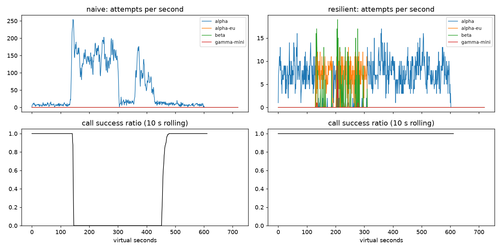

# Lab 25B — Report

**Họ tên / nhóm:** TranKimPhuong · **Mã:** 2A202602565 (theo tên thư mục repo)  
**Ngày:** 13/10/2026 · **Commit:** `fe99a308f11412a8a500eca0f31799c1038694a9`  
**Điểm tự động:** **84/88** với seed `25,26,27`.

Các bảng so sánh và thí nghiệm bên dưới dùng seed traffic/provider **25**, seed RNG của client **1**, thời gian ảo và cấu hình cuối trong `configs/gameday.yaml`. Availability là tỷ lệ **lượt user** thành công; amplification và retry_ratio tính theo **logical call**; p95 chỉ tính trên lượt thành công. Chi phí là đơn vị tương đối của simulator, không phải tiền thực tế. `—` nghĩa là metric không áp dụng.

Nguồn: [naive](gameday/naive.json), [resilient](gameday/resilient.json), [workflow](workflows.json), [SLO](slo.json), [cache](cache/cached.json), [thí nghiệm](experiments/part_f.json), [scoreboard](scoreboard.json).

## 1. Kết quả Game Day (naive vs của bạn)

| Băng | Client | availability | p95 (s) | amplification | retry_ratio | cost/turn | recovery (s) | PASS? |
|---|---|---:|---:|---:|---:|---:|---:|:---:|
| G1 | naive | 0.7194 | 7.157 | 7.738 | 6.738 | 2.163 | 4 | FAIL |
| G1 | resilient | 1.0000 | 4.830 | 1.064 | 0.002 | 2.127 | 0 | PASS |
| G2 | naive | 0.4560 | 15.034 | 9.904 | 8.904 | 4.627 | 155 | FAIL |
| G2 | resilient | 1.0000 | 5.940 | 1.036 | 0.007 | 2.111 | 0 | PASS |
| G3 | naive | 1.0000 | 4.768 | 1.164 | 0.164 | 2.328 | 0 | FAIL |
| G3 | resilient | 1.0000 | 4.737 | 1.053 | 0.033 | 2.131 | 0 | PASS |
| G4 | naive | 1.0000 | 13.764 | 1.004 | 0.004 | 2.008 | 0 | FAIL |
| G4 | resilient | 1.0000 | 5.611 | 1.029 | 0.004 | 2.117 | 0 | PASS |
| G5 | naive | 0.3699 | 5.359 | 17.030 | 16.030 | 2.124 | — | FAIL |
| G5 | resilient | 0.8179 | 5.481 | 1.003 | 0.003 | 2.504 | — | PASS |
| G6 | naive | 0.5170 | 4.836 | 12.344 | 11.344 | 2.009 | 0 | FAIL |
| G6 | resilient | 1.0000 | 6.105 | 1.056 | 0.020 | 2.186 | 0 | PASS |

ResilientClient đạt 6/6 băng trên cả ba seed `25,26,27` trong scoreboard. Với seed 25, G1 có **0** vi phạm `retry-after`; G5 có **0** retry lỗi client và **0** failover không cần thiết; G6 có **0** tuyến không tương thích. Primary share sau phục hồi là **1.000** ở G2, G4 và G6, đạt yêu cầu ≥ 0.8.

G5 vẫn có 413 lượt bị từ chối vì `client_error`; request malformed không thể được cứu bằng retry hoặc đổi model. Availability cao không đủ chứng minh chất lượng: naive vẫn đạt 100% availability ở G3 và G4 nhưng lần lượt vi phạm retry budget và latency. `recovery_s = 0` là kết quả tiêu chí tỷ lệ call thành công của simulator, không có nghĩa provider đã phục hồi tức thì hay mọi lượt đều hết chậm.

## 2. Cấu hình client và lý do

| Tham số | Giá trị | Vì sao, kèm bằng chứng |
|---|---:|---|
| `attempt_timeout_s` | 6.0 | Dành thời gian cho fallback trong deadline 30 s của cả lượt. Trên G2, timeout 8 s cho p95 11.024 s; 6 s cho 5.940 s. Timeout 30 s làm G6 mất 122 lượt. |
| `max_attempts_per_provider` | 2 | Tối đa một retry lỗi transient liên tiếp trước khi đổi provider. Cấu hình cuối có amplification 1.036 ở G2 và 1.056 ở G6; thử 5 attempt khi bỏ breaker/budget làm G2 lên 1.715. |
| `min_time_left_s` | 1.0 | Không giữ permit để gửi attempt khi còn dưới 1 s; timeout thực tế bị chặn theo deadline. G6 đạt 2385/2385 lượt thành công với timeout 6 s. |
| `backoff_base_s / cap_s` | 0.25 / 4.0 | Full jitter trải retry thay vì mọi request quay lại cùng nhịp. G1 đạt 0 vi phạm `retry-after`, amplification 1.064 với cooldown có jitter. |
| `retry_budget_ratio` | 0.10 | Request đầu nạp 0.1 token; retry cùng provider tiêu 1 token. G3 có retry_ratio 0.033; khi breaker bị vô hiệu hóa và cho 5 attempt, giữ budget cho 0.068, bỏ budget cho 0.160. |
| `retry_budget_min_per_s / max_tokens` | 0.5 / 20 | Cho phép burst ban đầu và retry khi traffic thấp, nhưng giới hạn tích lũy. Budget không phải trần tuyệt đối 10% ở mọi cửa sổ vì còn token ban đầu và refill theo thời gian. |
| `quota_cooldown_s` | 300 | Không lặp lại lỗi billing trên provider hết quota. G5 đạt 0 client-error retry, amplification 1.003 và availability 0.8179, thay vì 0.3699 của naive. Cooldown còn ít thời gian cũng không được dùng như rate-limit wait. |
| `breaker.window_size / min_calls` | 20 / 10 | Dùng kết quả gần đây, chờ đủ mẫu rồi đánh giá; tránh trip vì vài lỗi nền. G2 đạt recovery 0 s, amplification 1.036; G3 giữ availability 1.0. |
| `breaker.failure_rate_threshold` | 0.5 | Tách lỗi sức khỏe provider khỏi lỗi request/billing. G6 duy trì availability 1.0; G5 có 0 failover không cần thiết dù bad deploy. |
| `breaker.slow_call_s / slow_rate_threshold` | 5.0 / 0.6 | Coi success chậm cũng là suy giảm. G4 p95 giảm từ 13.764 s của naive xuống 5.611 s. |
| `breaker.open_duration_s` | 10.0 | Để provider giảm hàng đợi trước khi thử lại; không bỏ primary quá lâu. Primary share sau phục hồi ở G2/G4/G6 đều 1.000. |
| `breaker.half_open_max_probes / half_open_successes` | 2 / 2 | Tối đa hai probe đang bay, đóng breaker sau hai success nhanh. Test breaker xác nhận giới hạn probe; G2/G6 vẫn đạt primary share 1.000 sau phục hồi. |

Các số trên xác nhận **tổ hợp cấu hình** hoạt động; ngoài timeout và budget, chưa làm thí nghiệm tách riêng từng tham số để khẳng định giá trị tối ưu. Thứ tự fallback giữ nguyên `alpha → alpha-eu → beta → gamma-mini`; tool call loại `gamma-mini` vì không hỗ trợ tool calling. Callback success/failure dùng permit generation, còn cancel/rate limit/client error giải phóng permit mà không làm sai thống kê sức khỏe.

| Loại lỗi | Ghi breaker? | Retry cùng provider? | Failover? | Cooldown |
|---|---|---|---|---|
| CLIENT_ERROR | Không; release permit | Không | Không; `GiveUp` ngay | Không |
| QUOTA_EXHAUSTED | Không; release permit | Không | Ngay sang provider tiếp theo | 300 s theo provider |
| RATE_LIMITED | Không; release permit | Không retry ngay; đi fallback trước | Ngay; có thể chờ cooldown ngắn nếu hết tuyến | Ít nhất `retry_after`, cộng jitter 0–0.25 s |
| OVERLOADED / SERVER_ERROR / TIMEOUT | `on_failure` | Chỉ khi chưa đủ 2 attempt, breaker chưa OPEN, budget còn token và delay còn phù hợp deadline | Khi retry không còn phù hợp hoặc provider bị chặn | Breaker OPEN 10 s nếu trip |

Rate-limit wait chỉ được dùng khi cooldown còn ≤ 5 s, provider không OPEN, không thuộc quota cooldown và còn ≥ 1 s cho attempt. Không dùng wall-clock hay sleep; tất cả thời gian được tính từ `now`.

## 3. Ba thí nghiệm

Chạy `python scripts/run_report_experiments.py --seed 25`; toàn bộ cấu hình variant, metric và kết quả check nằm trong [part_f.json](experiments/part_f.json). Bảng 3.1 dùng `max_attempts_per_provider = 5` ở mọi hàng để chỉ thay đổi breaker/budget.

### 3.1. Retry budget là lớp phòng thủ cuối

Breaker “off” được tạo bằng `min_calls = 1000000000`. Budget “off” dùng `ratio = 100`, `max_tokens = 1e9`, `min_per_s = 1e6`, theo đề bài.

| Băng | Breaker | Budget | availability | amplification | retry_ratio | recovery (s) | PASS? |
|---|---|---|---:|---:|---:|---:|:---:|
| G2 | off | on | 0.9996 | 1.397 | 0.060 | 0 | PASS |
| G2 | off | off | 0.9479 | 1.715 | 0.473 | 55 | FAIL |
| G3 | off | on | 1.0000 | 1.136 | 0.068 | 0 | PASS |
| G3 | off | off | 1.0000 | 1.162 | 0.160 | 0 | FAIL |
| G2 | on | on | 1.0000 | 1.036 | 0.007 | 0 | PASS |
| G2 | on | off | 1.0000 | 1.036 | 0.007 | 0 | PASS |
| G3 | on | on | 1.0000 | 1.057 | 0.038 | 0 | PASS |
| G3 | on | off | 1.0000 | 1.060 | 0.046 | 0 | PASS |

Khi breaker không trip, budget giảm retry_ratio G2 từ 0.473 xuống 0.060 và recovery từ 55 s xuống 0 s, ngăn retry biến suy giảm provider thành sự cố dài hơn. G3 vẫn thành công 100% khi bỏ budget nhưng retry_ratio 0.160 vi phạm yêu cầu 0.10, cho thấy chỉ nhìn availability sẽ bỏ sót khuếch đại tải. Khi breaker hoạt động, kết quả G2 với và không budget giống nhau, còn G3 vẫn giảm retry_ratio từ 0.046 xuống 0.038 khi có budget. Vì breaker chặn provider unhealthy còn budget giới hạn retry ngay cả lúc breaker cấu hình sai hoặc chưa đủ mẫu, cần giữ cả hai lớp bảo vệ.

### 3.2. Timeout 30 giây

| Băng | Timeout (s) | availability | p95 success (s) | Lượt thành công / tổng | PASS? |
|---|---:|---:|---:|---:|:---:|
| G4 | 6 | 1.0000 | 5.611 | 2174 / 2174 | PASS |
| G4 | 30 | 1.0000 | 5.635 | 2174 / 2174 | PASS |
| G6 | 6 | 1.0000 | 6.105 | 2385 / 2385 | PASS |
| G6 | 30 | 0.9488 | 5.386 | 2263 / 2385 | FAIL |

G4 vẫn pass vì slow-call breaker phát hiện success chậm và chuyển traffic; tăng timeout không tự động làm toàn bộ lượt chờ 30 s. G6 mất **122 lượt vì deadline**: một attempt treo có thể tiêu hết thời gian còn lại, khiến không còn cơ hội fallback. p95 success ở G6 giảm xuống 5.386 s vì các lượt bị treo/thất bại không nằm trong mẫu latency, nên không thể diễn giải đây là cải thiện trải nghiệm. Timeout nên dựa trên latency khỏe của provider, độ biến động và số bước/fallback phải nằm trong deadline tổng; kết quả G2 với 8 s so với 6 s hỗ trợ chọn 6 s cho lab này.

### 3.3. Bỏ lọc tool calling

| G6 | availability | `incompatible_routes` | Lượt thành công / tổng | cost/turn | PASS? |
|---|---:|---:|---:|---:|:---:|
| Có lọc | 1.0000 | 0 | 2385 / 2385 | 2.186 | PASS |
| Bỏ lọc | 0.9027 | 232 | 2153 / 2385 | 2.259 | FAIL |

Bỏ lọc làm **232 lượt** thất bại với `incompatible_model_output`, đúng bằng số `incompatible_routes`. Theo góc nhìn sản phẩm, model rẻ có thể viết một câu chat nhưng không thực hiện được bước gọi tool cần thiết để xử lý hoàn tiền; chuyển request sang nó không tạo được một lượt thành công. Availability mất 9.73 điểm phần trăm, và cost trên mỗi lượt thành công còn tăng từ 2.186 lên 2.259. Vì vậy phải kiểm tra capability trước khi chọn tuyến, không chỉ kiểm tra provider còn sống hay giá rẻ.

## 4. Workflow hoàn tiền

Nguồn: [workflows.json](workflows.json), 500 session, seed 25; đơn vị overpaid là cent mô phỏng.

| Executor | completion | crashes | duplicate refunds | duplicate emails | lost refunds | overpaid (cent) | wasted LLM / crash |
|---|---:|---:|---:|---:|---:|---:|---:|
| naive | 1.0000 | 81 | 128 | 81 | 0 | 1574200 | 1.123 |
| yours | 1.0000 | 66 | 0 | 0 | 0 | 0 | 0.303 |

Executor mới lưu đủ 2500 checkpoint cho 500 × 5 bước và chỉ thực hiện 500 payment. Với seed 26/27, completion vẫn 1.0000, không duplicate/lost/overpaid; wasted LLM/crash là 0.241/0.338, dưới trần 0.6 ([multi-seed](workflows_multi_seed.json)).

**Chỉ idempotency key chưa đủ:** payment/email không bị thực hiện trùng, nhưng khi restart worker vẫn phải lặp classify, lookup và summarize nếu không có checkpoint, làm tăng chi phí và thời gian. **Chỉ checkpoint chưa đủ:** worker có thể chết sau khi payment đã commit nhưng trước khi checkpoint được lưu; restart sẽ gọi payment lần nữa, nên cần cùng idempotency key để provider trả lại kết quả cũ. Key được mã hóa ổn định từ `(session_id, step)`, không chứa UUID ngẫu nhiên và không đổi giữa retry/restart.

Thứ tự đúng là **execute → nhận success → ghi checkpoint → bước tiếp theo**. Nếu ghi checkpoint trước payment rồi worker chết trước khi tiền đi, restart sẽ bỏ qua bước chưa thực hiện và làm mất refund. `ServiceTimeout` được retry cùng key vì side effect có thể đã commit; `WorkerCrash` không bị bắt trong executor để runner tạo worker mới và resume từ store bền vững.

## 5. Alerting & error budget

Nguồn: [slo.json](slo.json), 43200 phút của 30 ngày. Delay là phút kể từ lúc sự cố bắt đầu đến lúc alert tương ứng bắt đầu.

| Sự cố | Mong đợi | Naive alerter | Burn-rate alerter | Delay burn-rate (phút) |
|---|---|---|---|---:|
| checkout_bug | page | page, delay 1 | page | 27 |
| provider_outage | page | page, delay 0 | page | 4 |
| deploy_blip | none | false page | không page | — |
| slow_leak | ticket | bỏ sót ticket | ticket, không page | 1337 |
| degraded_evening | page | page, delay 214 | page | 291 |
| night_spike | none | false page | không page | — |
| small_bump | none | false page | không page | — |

Burn-rate alerter tạo **3 page, 1 ticket, 0 false page**, so với naive **7 page, 0 ticket, 3 false page**. Các delay 27/4/291/1337 đều trong giới hạn 35/8/330/1800 phút tương ứng. Mỗi rule chỉ fire khi cả long và short window đạt threshold: 14.4× ở 1h & 5m, 6× ở 6h & 30m, 1× ở 3d & 6h. Prefix sums tính mỗi tổng cửa sổ trong O(1), không lấy trung bình không trọng số của tỷ lệ từng phút.

Budget availability 99.5% có **25901755 request**, cho phép **129508.8 bad request** sau làm tròn hiển thị; thực tế có **55618 bad**. Availability là **0.997853**, budget đã tiêu **42.95%**, còn **57.05%**; `freeze_releases = false` vì chưa hết budget. Quyết định dùng giá trị trước làm tròn, tránh đóng băng release chỉ vì phần budget còn ít được hiển thị thành 0.0000.

`small_bump` có 1794 bad trong 15211 request của 20 phút, dùng khoảng **1.39%** budget tháng. Trong khoảng từ đầu sự cố đến 60 phút sau khi kết thúc, burn 1h cao nhất **8.225×**, thấp hơn 14.4×, và burn 6h cao nhất **1.911×**, thấp hơn 6×. Vì các long window không đạt ngưỡng page, đây là biến động cần theo dõi nhưng không thỏa chính sách đánh thức on-call dù error ratio ngắn hạn vượt 5%.

## 6. Postmortem — Băng G2 với client naive (blameless)

### Tóm tắt

Tại t=120, `alpha` mất 75% năng lực trong 180 giây, làm hàng đợi tăng và request timeout. Client naive có ba tầng retry, delay cố định, không retry budget, breaker hay fallback, nên khuếch đại tải tới 9.904 attempt/logical call và giữ hệ thống trong trạng thái thất bại sau khi provider đã phục hồi tại t=300. Trong 2362 lượt, chỉ 1077 thành công; client resilient trên cùng băng đạt 2362/2362 lượt, amplification 1.036 và recovery 0 s theo metric của lab.

Hình được tạo bằng `make plot`. Hai biểu đồ attempts dùng trục y riêng; cần đọc giá trị trục, không so chiều cao đường giữa hai panel. Tỷ lệ ở panel dưới là **trailing 10 s**, tính trên call đã kết thúc, không phải tỷ lệ lượt user và không bao gồm call còn đang chờ.

### Ảnh hưởng

**1285/2362 lượt thất bại**, tương đương khoảng **54.40%**; p95 của các lượt thành công là **15.034 s**, cost/good turn **4.627**. Provider suy giảm trong `[120,300)` nhưng recovery metric chỉ đạt ở t=455, tức **155 s sau phục hồi provider**, hay 335 s tính từ trigger. Trong `[144,452)`, CSV ghi **0 success / 1214 call đã kết thúc**, một đoạn mất hoàn toàn success kéo dài 308 s.

Để quy đổi budget tháng, giả sử SLO 99.5% áp dụng cho **lượt user**, traffic ổn định **4 lượt/s** suốt 30 ngày, và đây là sự cố duy nhất: `N_tháng = 4 × 30 × 24 × 3600 = 10368000`; budget là `0.005 × N_tháng = 51840` lượt lỗi. Sự cố tiêu `1285 / 51840 × 100 = 2.48%` budget tháng, còn **97.52%**, nên **không vượt toàn bộ budget tháng**. Không dùng trực tiếp error ratio 54.40% của băng 10 phút làm phần trăm budget tháng; bộ SLI request ở mục 5 cũng có mẫu số khác với lượt user ở đây.

### Timeline

Nguồn: [CSV naive G2](gameday/naive_G2_overload_storm_timeseries.csv). Cột attempts/s là số attempt tới `alpha` trong `[t,t+1)`; cột success dùng tổng call ở `[t-9,t+1)`. Khi chưa có completion thì không kết luận availability từ cửa sổ đó.

| t (s ảo) | Sự kiện / quan sát | attempts/s | Success 10 s (ok/done) | Tỷ lệ |
|---:|---|---:|---:|---:|
| 110 | Trước sự cố, tải ổn định | 5 | 73/73 | 100% |
| 120 | Trigger: alpha mất 75% năng lực | 5 | 90/90 | 100% |
| 140 | Retry tăng mạnh; completion khỏe cũ còn che độ trễ | 216 | 16/16 | 100% |
| 143 | Đỉnh attempt của toàn băng | 254 | 7/8 | 87.50% |
| 150 | Thất bại đã xuất hiện rõ trên completion | 163 | 0/50 | 0% |
| 240 | Provider còn suy giảm, retry storm tiếp tục | 105 | 0/56 | 0% |
| 300 | Provider phục hồi năng lực; client vẫn thất bại | 115 | 0/43 | 0% |
| 360 | Không tự phục hồi ngay sau trigger kết thúc | 50 | 0/36 | 0% |
| 420 | Retry vẫn giữ tải trong giai đoạn phục hồi | 53 | 0/36 | 0% |
| 455 | Bắt đầu cửa sổ forward 30 s đạt ≥95% | 13 | 12/40 | 30% |
| 465 | Tỷ lệ trailing 10 s đang hồi phục | 9 | 98/112 | 87.50% |
| 480 | Trailing 10 s đã đạt 100% | 8 | 137/137 | 100% |

Tại t=143, riêng một giây đó có **0 completion**, nhưng cửa sổ trailing 10 s vẫn chứa 7 success/8 completion cũ. Metric recovery dùng **forward** `[455,485)`: **352/368 = 95.65%** call thành công. Vì vậy `recovery_s = 455 - 300 = 155` không mâu thuẫn với trailing ratio tại t=455 mới đạt 30%.

### Trigger, root cause và vòng lặp tự duy trì

**Trigger** là sự giảm năng lực GPU của provider, xảy ra ngoài client. **Root cause phía hệ thống** là ba tầng retry nhân tối đa 4 × 3 × 3 = 36 attempt/call, tất cả lỗi đều bị retry với delay cố định 0.2 s, không tôn trọng retry-after và không có cơ chế giảm tải hoặc chuyển tuyến.

Vòng lặp là: giảm capacity → hàng đợi tăng → client timeout/529 → retry tạo thêm request → hàng đợi tiếp tục tăng. Request đã timeout ở client vẫn chiếm công xử lý phía provider; 429 do rate limit lại bị retry sớm, tạo thêm burst mà không tăng năng lực phục vụ. G2 naive có **34475 attempt**, **26298 lỗi rate limit** và **28381 vi phạm retry-after**; trong `[120,300)` có **24702 attempt**, trung bình 137.23/s.

Sau t=300, năng lực trở lại nhưng hàng đợi và các call đang retry vẫn tồn tại. Trong `[300,455)`, client còn gửi **7625 attempt**, trung bình **49.19/s**, và chỉ có **8/554 call thành công**; tải attempt trung bình này còn vượt tenant rate limit thông thường 20 rps. Đây là **metastable failure**: mất capacity đã hết nhưng feedback từ client và work cũ giữ trạng thái xấu. Các số CSV chứng minh tải/recovery kéo dài; cơ chế request timeout vẫn chạy phía server được xác nhận bởi thiết kế simulator, không suy ra queue depth cụ thể chỉ từ biểu đồ.

### Điều gì giúp / điều gì làm tệ hơn

Thời gian ảo, seed lặp lại, metric tách logical call/attempt và CSV giúp tái hiện nguyên nhân mà không quy trách nhiệm cá nhân. Việc tắt breaker trong thí nghiệm nhưng giữ budget vẫn giữ G2 amplification ở 1.397, cho thấy lớp bảo vệ độc lập có giá trị. Ngược lại, nhiều lớp retry cùng mặc định, chỉ theo dõi success của call đã kết thúc, và không kiểm tra khả năng tự hồi phục sau restore khiến tác động của overload bị che hoặc kéo dài. Với client mới, full jitter, budget, breaker theo error/slow rate và fallback đưa G2 về 100% lượt thành công, cost/good turn 2.111.

### Action items đề xuất

Owner là **vai trò đề xuất**, chưa phải phân công đã được xác nhận. Các mục này là cải tiến quy trình/hệ thống; không gửi thông báo hay tạo ticket bên ngoài trong lab.

| # | Hành động | Loại | Owner đề xuất | Cách kiểm chứng |
|---|---|---|---|---|
| 1 | Chỉ cho một tầng sở hữu retry; giới hạn attempt và budget, tắt retry chồng ở SDK/gateway khi đưa vào production | prevent | Nhóm client | CI G2 amplification ≤ 1.6, G3 retry_ratio ≤ 0.10 trên ≥3 seed; fault test xác nhận 400 không retry. |
| 2 | Dùng breaker theo failure/slow rate, permit generation và giới hạn HALF-OPEN probes | mitigate | Nhóm platform | G2 recovery ≤ 30 s; primary share sau restore ≥ 0.8; test đồng thời chỉ cấp tối đa 2 probe. |
| 3 | Dashboard và burn-rate alert cho user SLI; bổ sung attempt/logical call, timeout/529/429 và breaker OPEN | detect | SRE/on-call | Replay 30-day SLI: page đúng hạn cho 3 incident lớn, 0 false page; G2 dashboard chỉ rõ amplification 9.904 của naive. |
| 4 | Kiểm tra fallback theo capability và deadline tổng trong mọi release client | prevent | Nhóm agent | G6 availability ≥ 0.95, incompatible_routes = 0; ablation bỏ lọc tái hiện 232 lượt lỗi để xác nhận guard cần thiết. |
| 5 | Đưa replay sau restore và thí nghiệm breaker lỗi cấu hình vào game day định kỳ | detect | Nhóm reliability | Bộ test bao gồm G2/G3 budget on/off; lưu CSV và so recovery/amplification, không chỉ availability. |

## 7. Một điểm yếu còn lại

Client bảo vệ availability bằng fallback nhưng vẫn trả chi phí cao hơn khi dùng model đắt hoặc gặp lỗi request. Trên G6 seed 25, `beta` nhận **2112 attempt** và cost/good turn là **2.186**, cao hơn khoảng **8.81%** so với **2.009** của naive; tuy nhiên naive chỉ hoàn tất 51.70% lượt, nên không được xem chi phí thấp hơn đó là phương án tốt hơn. Trên G2 seed 26, p95 còn **9.985 s** dù pass, cho thấy cửa sổ phát hiện và probe vẫn có thể gây lượt chậm.

Bước cải tiến đề xuất là quan sát latency/chi phí theo task và provider, đánh giá chọn model rẻ phù hợp cho chat trong khi giữ tool route có capability, và chia deadline còn lại giữa các bước để tránh dùng hết ở attempt đầu. Cần thử trên nhiều seed, intensity và brown-out trước khi đổi thứ tự route; không hard-code thời điểm băng. Trường hợp mọi provider cùng sập vẫn làm workflow/tool và FAQ cá nhân thất bại: C1 tổng availability chỉ **91.24%**, thấp hơn FAQ availability **96.45%** dù cache hoạt động đúng.

## 8. Cache (Part G)

Nguồn: [không cache](cache/resilient.json), [có cache](cache/cached.json), [thí nghiệm kiểm soát](experiments/part_f.json). C1 có **1720 FAQ lượt** trong tổng **2808 lượt**, seed 25.

| Client | availability | faq_availability | cache_hit_ratio | stale_served | wrong_answers | outdated_answers | cost/turn | PASS? |
|---|---:|---:|---:|---:|---:|---:|---:|:---:|
| resilient (không cache) | 0.8373 | 0.8424 | 0.000 | 0 | 0 | 0 | 1.386 | FAIL |
| cached | 0.9124 | 0.9645 | 0.652 | 157 | 0 | 3 | 0.915 | PASS |

Cache tăng FAQ availability **12.21 điểm phần trăm**, giảm cost/good turn khoảng **33.98%**, và phục vụ **157** lượt từ entry stale sau khi provider bỏ cuộc. C1 pass cả ba seed 25/26/27; seed 26/27 có FAQ availability **0.9563/0.9638**, hit ratio **0.656/0.653**, 0 wrong và 2 outdated ở mỗi seed ([multi-seed](cache/multi_seed.json)).

| Tham số `cache:` | Giá trị | Vì sao |
|---|---:|---|
| `similarity_threshold` | 0.90 | Cùng TTL 60/stale 300: 0.80 tạo 157 wrong; 0.90 tạo 0 wrong và hit ratio 0.652; 0.97 vẫn 0 wrong nhưng hit ratio giảm còn 0.581. |
| `ttl_s` | 60 | TTL 30/60/300 cho outdated 2/3/95. TTL 60 giữ dưới trần 15 với hit ratio 0.652, cao hơn 0.592 của TTL 30. |
| `max_stale_s` | 300 | Cửa sổ stale sau TTL đủ bao phủ outage 120 s và độ tuổi entry trước outage. Tắt stale làm FAQ availability giảm từ 0.9645 xuống 0.8733. |
| `max_entries` | 500 | Giới hạn bộ nhớ và dùng LRU; unit test xác nhận eviction theo `last_used`. Chưa có thí nghiệm capacity để chứng minh 500 là tối ưu. |

### 8.1. Ngưỡng similarity

Giữ TTL 60 s, max_stale 300 s và max_entries 500 ở mọi hàng.

| Threshold | hit ratio | wrong_answers | `wrong_answers_by_reason` | cost/turn | PASS? |
|---:|---:|---:|---|---:|:---:|
| 0.80 | 0.666 | 157 | `other_question: 157` | 0.965 | FAIL |
| 0.90 | 0.652 | 0 | `{}` | 0.915 | PASS |
| 0.97 | 0.581 | 0 | `{}` | 0.964 | PASS |

Threshold 0.80 coi những intent khác nhau nhưng embedding gần là cùng câu hỏi, làm 157 câu trả lời sai loại. Các cặp minh họa trong catalog có cosine vượt 0.80: “Chính sách hoàn tiền của shop thế nào?” ↔ “Hoàn tiền mất mấy ngày?” (**0.8616**), đổi size ↔ đổi màu (**0.8148**), phí ship nội thành ↔ ngoại tỉnh (**0.8409**), ví điện tử ↔ COD (**0.8465**); đây là ví dụ near-miss đo từ embedding, không phải phân rã số 157 theo từng cặp. Threshold 0.90 chặn các near-miss này và vẫn giữ hit ratio 65.2%; 0.97 giảm hit ratio xuống 58.1% mà không cải thiện số wrong trong băng public. Chi phí ở 0.80 không thấp hơn 0.90 dù hit nhiều hơn vì cost/good turn chia cho số lượt thành công, loại các trả lời sai.

### 8.2. TTL

Giữ threshold 0.90, max_stale 300 s và max_entries 500.

| TTL (s) | hit ratio | outdated_answers | wrong_answers | cost/turn | PASS? |
|---:|---:|---:|---:|---:|:---:|
| 30 | 0.592 | 2 | 0 | 0.955 | PASS |
| 60 | 0.652 | 3 | 0 | 0.915 | PASS |
| 300 | 0.731 | 95 | 0 | 0.863 | FAIL |

Webhook tại t=150 xóa entry dựa trên tài liệu hoàn tiền đã đổi, kể cả entry stale, nhưng thay đổi shipping tại t=480 không có webhook nên client không biết phải invalidate. TTL 300 giữ câu trả lời shipping cũ lâu và tạo 95 outdated, trong khi TTL 60 chỉ tạo 3, dưới trần 15. TTL 30 giảm thêm một outdated nhưng hit ratio thấp hơn và cost cao hơn, nên chọn 60 s. Khi provider khỏe, entry quá TTL phải được lấy lại từ provider; nếu silent update xảy ra trong outage, stale-if-error có thể kéo tuổi câu trả lời tới TTL + max_stale = 360 s, nên TTL riêng không bảo đảm fresh tuyệt đối trong trường hợp đó.

### 8.3. Stale-if-error

Giữ threshold 0.90, TTL 60 s và max_entries 500.

| max_stale (s) | FAQ availability | hit ratio | stale_served | wrong | outdated | PASS? |
|---:|---:|---:|---:|---:|---:|:---:|
| 0 | 0.8733 | 0.561 | 0 | 0 | 3 | FAIL |
| 300 | 0.9645 | 0.652 | 157 | 0 | 3 | PASS |

Không có stale, FAQ availability chỉ 87.33%, dưới ngưỡng 93%, vì entry hết TTL trong lúc mọi provider sập. Cho stale 300 s tăng availability thêm **9.12 điểm phần trăm** và cứu 157 lượt mà không tạo wrong answer. Wrapper chỉ trả stale sau `GiveUp`, lookup lại tại thời điểm đó để không dùng entry đã bị invalidation trong lúc attempt đang bay; stale không được dùng để bỏ qua provider khỏe khi entry đã hết fresh TTL.

### Câu hỏi cá nhân và alert khi cache che outage

Không cache “Đơn #48213 của tôi đang ở đâu?” kể cả tách theo user: user scope ngăn lộ dữ liệu sang người khác nhưng không ngăn cùng user nhận trạng thái order/refund/điểm đã cũ. Những trạng thái này thay đổi theo giao dịch và không có cơ chế invalidation đủ mạnh trong lab; trường `request.personal` do đó loại cả store lẫn lookup. Scope `prompt_version` ngăn prompt v1 phục vụ request v2; source invalidation ngăn dùng lại tài liệu đã được thông báo thay đổi. Kết quả cuối có `wrong_answers = 0`, gồm không có `other_user`, `personal_cached`, `old_prompt` hay `ignored_invalidation`.

Giữ user-facing availability SLI để đo tác động thực tế, đồng thời theo dõi provider success/error ratio **chỉ trên attempt thực sự gửi**, timeout/503/529, số breaker OPEN, cache-hit/stale-served ratio và tuổi entry stale. Không tính cache hit vào mẫu số provider-health SLI vì sẽ làm outage trông như provider vẫn khỏe; nếu mọi breaker OPEN và provider attempt success bằng 0 trong outage thì cần cảnh báo đường provider dù FAQ vẫn được trả từ cache. Khi breaker đã chặn mọi attempt, mẫu số provider metric có thể bằng 0 chứ không có success: cần kết hợp trạng thái breaker/last failure, không diễn giải “không có lỗi mới” thành đã hồi phục. Ngưỡng cảnh báo provider/cache cụ thể này là đề xuất observability, chưa được triển khai thành rule riêng trong lab.
